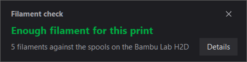

# Bambu Filament Guard

**Know, before you print, whether the spools on your Bambu Lab printer hold enough filament.**

[](https://github.com/parthalon025/bambu-filament-guard/actions/workflows/tests.yml)
[](https://github.com/parthalon025/bambu-filament-guard/releases/latest)
[](LICENSE)


Bambu Filament Guard is a Windows companion to Bambu Studio. Each time you slice a plate, it works out how many grams of each filament the print needs, purge and prime tower included. It then asks the printer how much each spool has left, takes off what the print already running still needs, and shows the result in a card inside Bambu Studio's window. You see the answer before you send the job. It does not change the project or the printer: it only reads the printer's status over your local network, and it makes no internet connection.


*The guard's own card, for a plate checked while the same plate prints. After the running print, two of its filaments would not have enough, and one would be tight. The job is made up, with figures modelled on the print described in [The running print](docs/running-print.md).*

## Why

The AMS's remaining-filament figure is an estimate. It counts what it has fed, so its error grows as the spool empties. On 2026-11-19 a 1 kg spool reported 105 g and ran dry after 84–85 g, one gram before the end of a print that needed 85.3 g. Bambu Studio's own warning covers only the tray you pick. The guard checks every filament against every matching spool, with a reserve, and accounts for the print that is already running.

## Key features

- **Every filament, every plate.** Checks each plate as soon as it is sliced, and all the project's sliced plates again when "Send print job" opens (of more than 30, the 30 sliced last; the card says how many were left out).
- **Batch-printing aware.** A plate sliced while another prints is checked against what the spools will hold when it can start. See [The running print](docs/running-print.md).
- **Learns each tray's accuracy.** Follows the prints and learns, per tray, how far its reading can be trusted: what it reads when a spool runs dry, and how far it falls per gram printed. As it comes, this only makes a check stricter. An experimental setting, off unless you turn it on, measures the reserve from the guard's own forecasts instead of fixing it. See [Learning from previous prints](docs/learning.md).
- **Spools without RFID.** Enter a weighed amount once, and the guard counts it down as prints use it. See [Spools without a reading](docs/manual-amounts.md).
- **Scriptable.** `check` gives a plain-text or JSON result for any sliced file, with exit codes a script can act on. See [Commands](#commands).
- **Read-only and local.** Sends the printer no command that changes it. See [Privacy and security](#privacy-and-security).

## Contents

- [Compatibility](#compatibility)
- [Install](#install)
- [Usage](#usage)
- [Commands](#commands)
- [Documentation](#documentation)
- [Privacy and security](#privacy-and-security)
- [Contributing](#contributing)
- [Changelog](#changelog)
- [Licence](#licence)

## Compatibility

### Requirements

- Windows 10 or 11
- Bambu Studio (not OrcaSlicer)
- The printer reachable on the local network, with its LAN access code entered in Bambu Studio
- Python 3.13 or later, only when running from source

The amount on a spool is read automatically for Bambu spools with an RFID tag, in an AMS. For any other spool, you enter the amount by hand.

### Tested printers

| Printer | Sliced files | On the printer |
|---|---|---|
| H2D | Tried | Tried, with an AMS (firmware 01.04.20.00): prints run with the guard |
| A1 mini | Tried | Answered a status request; it had no AMS, so no spool amounts were seen |
| A1, P1P, P1S, X1, X1 Carbon, X1E, P2S, H2S, H2D Pro, H2C, A2L, X2D, H3C | Tried | Not tried |

**Sliced files:** for every model above, the grams per layer the guard counts from Bambu Studio 02.09.01.70 slices add up to Bambu Studio's own totals, each filament to within 0.005 g.

**On the printer:** reading the spools has been tried on the H2D only. Which nozzle an AMS feeds is decoded for the H2D. Where that cannot be read, a spool counts for either nozzle.

A report from any other model, whether it works or not, is welcome: [Printer report](https://github.com/parthalon025/bambu-filament-guard/issues/new?template=printer_report.yml).

## Install

### Packaged (no Python needed)

1. Download `BambuFilamentGuard-<version>.zip` from the [latest release](https://github.com/parthalon025/bambu-filament-guard/releases/latest).
2. Unzip it where it can stay: it runs from that folder.
3. Open `Install.cmd`.

`Uninstall.cmd` removes it. `README.txt` in the folder says what Windows may ask at the first start. `python build.py` makes such a zip in `dist\`, on the Python and from the wheels the script and `requirements-bundle.txt` name.

### From source

With Python 3.13 or later:

```powershell
pip install -r requirements.txt       # paho-mqtt, pystray and Pillow
python filament_guard.py install      # start automatically, and now
```

`python filament_guard.py uninstall` removes the shortcut and stops it.

Either way, the guard starts with Windows and waits. Its icon, a spool, is in the notification area while Bambu Studio runs.

## Usage

There is nothing to do beyond slicing as usual. When a plate is sliced, the guard reads from its G-code the grams each filament needs, asks the printer what is left on every spool, takes off what a running print still needs, and shows the answer as a **Filament check** card inside Bambu Studio's window, bottom right, under the slicing result.

With enough of everything the card is one line that goes away after 8 seconds:



When a filament falls short it is the full table, as in the picture at the top, and it stays until you close it, until that plate is sliced again, or until a check finds something worse. From it you can check again after swapping a spool, ignore a finding for that plate of the project (for a week, and as long as it does not get worse), or enter the amount of a spool the printer cannot measure.

| Result | Meaning |
|---|---|
| Enough | One matching spool holds the need plus the reserve. |
| Tight | One spool holds the need, without the reserve. |
| Needs two spools | No single spool holds it; spools that AMS auto refill goes on between do together: the same product and colour, both in an AMS. AMS auto refill must be on. |
| Not enough | The matching spools together hold less than the need, or hold it only with a spool AMS auto refill does not go on to (another product or shade, the external spool): the note names those and their amounts. |
| Not loaded | No spool of that material is loaded where the print's nozzle can reach it. |
| Colour not loaded | The material is loaded, this colour of it is not. The nearest spool is named and counts for nothing. |
| Unknown | The matching spool reports no remaining amount, or Bambu Studio gives the filament no weight (its profile has density 0). Shown as one line, like "enough", unless "Warn when a spool's amount is unknown" is ticked in the icon's settings. |

The card's buttons, the icon's menu and settings, how spools are matched and how the reserve is set are in [Using the guard](docs/using.md).

## Commands

```powershell
python filament_guard.py status       # running? where is the log?
python filament_guard.py check        # the newest slice of the running Bambu Studio, as text
python filament_guard.py check FILE.gcode.3mf --times 9   # nine prints of a sliced file
python filament_guard.py trays        # the spools each printer reports
python filament_guard.py learned      # what was learned from previous prints, per tray; --forget [TRAY] starts again,
                                      # --forget-weigh TRAY takes back that tray's latest weigh-in
python filament_guard.py selftest     # can the guard read this Bambu Studio and reach the printers?
python filament_guard.py uninstall    # remove the shortcut and stop
```

`check` exits with a code a script can gate on: `--json` prints the full answer; `--popup` also shows the card. For a file with several plates it answers for each plate and then for all plates together, which is what "Print all plates" needs; the exit code is the worst of those answers. When there is nothing to answer for (no slice, a file that cannot be read, an error inside the check), it prints one line that says why, as `{"error": "…"}` with `--json`, and exits with 3.

| Exit code | Meaning |
|---|---|
| 0 | Enough |
| 1 | Tight, two spools needed, or amount unknown |
| 2 | Not enough, or the material or colour is not loaded |
| 3 | Could not be checked: no slice, a file or a printer that cannot be read, or a command line that was not understood (a mistyped option, `--times` below 1) |

> [!TIP]
> **After a Bambu Studio update**, run `selftest` (or Self-test in the icon's menu). When Bambu Studio writes a slice the guard cannot read, a card says so once for that version, and every such file is in the log.

**Log and state** are in `%LOCALAPPDATA%\BambuFilamentGuard\`, with the grams per layer of the last 30 slices in `profiles\` and what was learned in `learned.json`. Settings are saved to `config.json` beside the script.

## Documentation

| Page | What it covers |
|---|---|
| [Using the guard](docs/using.md) | How it works step by step, the card and its buttons, the icon and its settings, what the results mean, the reserve |
| [The running print](docs/running-print.md) | How the print on the printer is counted before a new plate is checked |
| [Learning from previous prints](docs/learning.md) | What is recorded, the model, what is learned and what it changes, the experimental measured reserve and what it cannot see, weigh-ins, the simulation |
| [Spools without a reading](docs/manual-amounts.md) | Entering the amount of a spool the printer cannot measure, and how it is counted down |
| [Limits](docs/limits.md) | What the guard cannot read or does not yet know, and what it does in each case |

## Privacy and security

The guard makes no internet connection, and it sends the printer no command that changes it: no print, pause, stop, temperature or motion command. The LAN access code is read from Bambu Studio's configuration each time and goes to the printer only. What it reads, sends and keeps, and how to report a vulnerability, is in [SECURITY.md](SECURITY.md).

## Contributing

How to run the tests, the conventions a change follows, the layout of the code and what a useful report holds are in [CONTRIBUTING.md](CONTRIBUTING.md). Bugs: [open an issue](https://github.com/parthalon025/bambu-filament-guard/issues/new/choose).

## Changelog

What each version changed is in [CHANGELOG.md](CHANGELOG.md).

## Licence

MIT: see [LICENSE](LICENSE). The packaged zip also holds Python, Tcl/Tk, paho-mqtt, pystray (LGPL-3.0), Pillow and six, each under its own licence. Those are in the zip: `LICENSE.txt` (Python), `tcl\tk8.6\license.terms` (Tcl/Tk) and the `dist-info` folders in `Lib\site-packages`.
