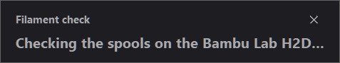

# Bambu Filament Guard

Warns, for every filament of a print sliced in Bambu Studio, when the spools on the printer do not hold enough of it.

[](https://github.com/parthalon025/bambu-filament-guard/actions/workflows/tests.yml)
[](https://github.com/parthalon025/bambu-filament-guard/releases/latest)
[](LICENSE)


A plate checked while the same plate prints: after the running print, two of its filaments would not have enough, and one would be tight. The pictures are the guard's own card. The job in them is made up, with figures modelled on the print of 2026-11-19 described under "The running print".

- Checks every filament of every plate you slice, in any project, against what the spools on the printer hold, purge and prime tower included: as soon as the slice is done, and again for all the project's sliced plates when "Send print job" opens.
- Counts the print that is running, when it was sliced on this computer: a plate sliced while another prints is checked against what the spools will hold when it can start.
- Learns, per tray, how far the AMS's reading can be trusted, from the prints it follows, and scores its own forecasts against what each print took. Until they have earned it, it only makes a check stricter; then the reserve is measured instead of fixed, and is smaller for a tray that proves accurate.
- Read-only, on your LAN: it reads the printer's status and the files Bambu Studio writes while it slices, and sets nothing in the project.

## Does it work with my printer?

| Printer | Sliced files | On the printer |
|---|---|---|
| H2D | Tried | Tried, with an AMS (firmware 01.04.20.00): prints run with the guard |
| A1 mini | Tried | Answered a status request; it had no AMS, so no spool amounts were seen |
| A1, P1P, P1S, X1, X1 Carbon, X1E, P2S, H2S, H2D Pro, H2C, A2L, X2D, H3C | Tried | Not tried |

Sliced files: for every model above, the grams per layer the guard counts from Bambu Studio 02.09.01.70 slices add up to Bambu Studio's own totals, each filament to within 0.005 g (see "The running print"). Reading the spools has been tried on the H2D only; on the other models it has not been tried on a machine. A report from one, whether it works or not, is welcome: [Printer report](https://github.com/parthalon025/bambu-filament-guard/issues/new?template=printer_report.yml).

On any of them the guard needs Windows 10 or 11, Bambu Studio (not OrcaSlicer), and the printer reachable on the local network with its LAN access code in Bambu Studio. It reads the amounts of spools the printer can measure: Bambu spools with an RFID tag, in an AMS. For any other spool the amount is entered by hand (see "Spools without a reading"). Which nozzle an AMS feeds is decoded for the H2D; where that cannot be read, a spool counts for either nozzle.

## Install

Without Python: download `BambuFilamentGuard-<version>.zip` from the repository's [Releases](https://github.com/parthalon025/bambu-filament-guard/releases), unzip it where it can stay, and open `Install.cmd`. It runs from that folder; `Uninstall.cmd` removes it. `python build.py` makes the same zip in `dist\`.

From source, with Python 3.13 or later:

```powershell
pip install -r requirements.txt       # paho-mqtt, pystray and Pillow
python filament_guard.py install      # start automatically, and now
```

The guard starts with Windows and waits. Its icon, a spool, is in the notification area while Bambu Studio runs.

## How it works

Bambu Studio has no plugin interface (v02.09.01.70: the `plugins` folder holds its network libraries only), so the guard runs beside it:

1. Bambu Studio writes the G-code of each plate it slices to `%TEMP%\bamboo_model\<day>\<time>#<pid>#<id>\Metadata\.<pid>.<n>.gcode`. The guard watches that folder.
2. From the G-code it reads the grams each filament needs (purge and prime tower included), and its material, colour, product and nozzle.
3. It asks the printer the plate was sliced for what is left on every spool (read-only status over the LAN). When the printer is running a print, it first takes off each spool what that print still needs from it: the answer is for the moment the new print could start. See "The running print".
4. The answer appears as a "Filament check" card inside Bambu Studio's window, bottom right, under the slicing result. With enough of everything it is one line that goes away after 8 seconds; when a filament falls short it is the full table, and it stays until closed or until the next slice.
5. When "Send print job" opens, the guard checks every sliced plate of the project again. The worst answer shows beside that dialog when it is a warning, and names its plate.

The card belongs to Bambu Studio's window: it is above that window and no other, moves and minimises with it, follows its dark or light mode, and never takes the keyboard. It is still drawn by the guard, which must be running.

## The card

With enough of everything the card is one line:


A check takes a second or three, because the guard asks the printer each time. While one runs that you are waiting for (a plate you just sliced, or one you asked for from the icon) the card says so at once in one line, "Checking the spools on the Bambu Lab H2D…", and the answer takes its place.



For a new slice the line does not cover a full card that is still open; asked for from the icon, it takes the place of any card, as its answer will. Beside "Send print job" nothing shows until there is a warning.

When the guard starts, the first time Bambu Studio runs it shows one line, "Bambu Filament Guard 1.4.0 is watching for sliced plates", which goes away by itself; after `Install.cmd` the install card says it instead. A one-line card that comes while Bambu Studio is minimised waits for its window, and its seconds count from when it shows. With "One line when there is enough" turned off, quiet was asked for: a new slice shows no "Checking…" line, and the guard no start line.

| Button | Does |
|---|---|
| Check again | Asks the printer again, for the same slice: after swapping a spool, no re-slice is needed. |
| Ignore for this project | This finding shows as one line from now on, until it changes. "Stop ignoring" on the full card (Details) undoes it. |
| Amount in A3… | For a spool the printer cannot measure: enter the grams left. See "Spools without a reading". |
| Weigh C3… | Offered when weighing that spool would settle the answer: enter the grams on it. See "Learning from previous prints". |
| Details | On the one-line card: the full table. |

## The icon

Its colour and tooltip are the last result. A click shows that result again; before there is one, it checks the newest slice. A click while that check runs shows the "Checking…" line again and starts no second check. The menu: check the newest slice now, pause, self-test, the log, forget what was learned, and the settings:

- One line when there is enough (`ok_seconds`)
- Warn when a colour is not loaded / when a spool's amount is unknown (`popup_on`)
- Check again at "Send print job" (`at_send`)
- Reserve: 2, 3 or 5 % of the full spool (`spool_reserve_pct`)
- Learn from prints, tray by tray (`learn`, on; see "Learning from previous prints")
- Measure the reserve from past prints (`measured_reserve`, on)
- Start automatically

Settings are saved to `config.json` beside the script, which holds only what was changed. The keys, their defaults and their meaning are `DEFAULTS` at the top of `filament_guard.py`.

## What the results mean

| Result | Meaning |
|---|---|
| Enough | One matching spool holds the need plus the reserve. |
| Tight | One spool holds the need, without the reserve. |
| Needs two spools | No single spool holds it; the matching spools together do. AMS auto refill must be on. |
| Not enough | The matching spools together hold less than the need. |
| Not loaded | No spool of that material is loaded where the print's nozzle can reach it. |
| Colour not loaded | The material is loaded, this colour of it is not. The nearest spool is named and counts for nothing. |
| Unknown | The matching spool reports no remaining amount. Shown as one line, like "enough", unless `popup_on` names it. |

A spool matches a filament when it is the same material, on the nozzle that prints it, in the project's colour; spools of the same product come first. A spool of similar colour but another product is named in the note and not counted.

**The reserve.** The AMS's figure is an estimate: it counts what it has fed, so its error grows as the spool empties. On 2026-11-19 a 1 kg spool reported at 105 g ran dry after 84-85 g, one gram before the end of a print that needed 85.3 g. So "enough" asks for the need plus the larger of 10 % of the need (`margin_pct`) and 3 % of the spool's full weight (`spool_reserve_pct`: 30 g on a 1 kg spool). Below that the result is "tight", and the full card shows. With learning, once it has the evidence, the reserve is measured from the guard's own past forecasts instead (see "Learning from previous prints").

## The running print

In batch printing the next plate is sliced while one prints. On 2026-11-19 a plate needing 85.3 g of blue was printing from a spool that read 105 g; the same plate, sliced again for the next run, was checked against those 105 g, although after the running print the spool would hold about 20 g. So every check counts the print that is running:

- For each plate it sees sliced, the guard keeps how many grams of each filament every layer takes, counted from the G-code the way Bambu Studio counts its own totals: the moves along X or Y that extrude, and the purge at each filament change. The purge is real moves between `; FLUSH_START` and `; FLUSH_END` (A1, P1, X1), or, where the printer purges by itself, the `;VG1` comments between `; VFLUSH_START` and `; VFLUSH_END` (H2, P2S, A2L, X2D, H3C). Of each purge, as much as the nozzle holds counts for the filament it pushes out, the rest for the one loaded. Moves of the filament alone (load, prime, retract) are not counted; Bambu Studio does not count them either. This was measured on Bambu Studio 02.09.01.70 slices for those printer families, where every filament came to within 0.005 g of Bambu Studio's total; only the H2D has been tried on a real printer. A filament further than 0.02 g (or 0.2 %) from its total gives the slice no profile, and the log says by how much: a Bambu Studio that counts differently shows there.
- The job the printer runs is matched to its slice (project name, layer count and plate) and to the trays it uses (the job's tray mapping). What it still needs is its grams from the layer the printer is on to the end, that layer counted whole; while the printer prepares a job, all of it.
- That is taken off each spool's reading before the check. The note of a filament says so: "C3 reads 105 g, of which the running print still needs 85 g". The card says whether the running print was counted.
- What the running print needs beyond what its tray holds comes, with AMS auto refill, from another loaded spool of the same filament (the same material and colour, the same product where both name one, for the same nozzle): it is taken off those, the fullest first, and the note says so ("C3 reads 20 g; the running print still needs 85 g: 65 g more than it holds, taken off C4"). When no such spool is loaded, the card says that the print running now needs that much more than the loaded spools hold: a warning about the running print, whatever the checked plate needs.
- An amount entered by hand is counted down by the guard as prints draw on it (see "Spools without a reading"). Until it has taken the running print off it, the check takes that print's need off it like off a reading; once it has, not again.

## Learning from previous prints

The AMS's reading is an estimate, and not equally good in every tray. On 2026-11-19 tray C3 read 105 g and ran dry after 84-85 g of a print: it read about 20 g when it was empty. In the same print tray B4 fell 49 g for a need of 49.1 g: that tray tracks well. A fixed reserve treats both alike. So the guard learns, per printer and tray, how far that tray's reading can be trusted.

**What is recorded.** While learning is on, the guard follows a printer it has checked in the last 30 minutes, or that is printing, over the same read-only link it uses for entered amounts: it asks once, at each connection, for the full status, then reads the status reports every 3 seconds, and sends nothing else. For each job matched to a slice with a per-layer profile, it records per tray: the spool (its RFID tag when it has one), the reading before the first layer, at the start of each layer (at most 60 per print, thinned evenly), and a minute after the print finished; and how many grams the profile has that tray give over the same span, printed and purged apart. A record is used only when it is sound: the same spool throughout, a reading that never rose, no gap of ten minutes or more in following, the tray never empty, and the print seen to finish. A run-dry is a tray the print is drawing on at that point (by its profile) that is reported without a spool in two looks in a row, having read 50 g or less: its last reading is recorded, with the printer's error and HMS codes at that moment, raw, to judge it by later. A fuller spool, or one the print was not drawing on then, was taken out: that is logged and teaches nothing. A print not sliced on this computer records no run-dry, as what it draws on and when cannot be told.

With each sound whole print followed from before its first layer it also keeps a score: what the guard, as it stood before that print, forecast the tray's reading would fall by, and what it fell. With every print, whatever became of it, it keeps the lowest reading each tray was seen still feeding at.

**The model**, in the reading's own grams, so that every part of it can be seen: a print of N sliced grams makes the tray's reading fall by about rho x N, plus pre before the first layer; the spool is empty when the reading reaches a. A print fits when the reading is at least rho x N + pre + a + a margin.

**What is learned**, per tray, over its prints since any change was noticed in it (see below), each print weighted 0.95 for every print since, so that one 14 prints old counts half:

| Number | What it is | Used from |
|---|---|---|
| rho | how far the reading fell for each sliced gram: each print's ratio, clipped to 0.9..1.15 (to the printer's own 5 % and 95 % quantiles once it has 20), the tray's own drawn toward the printer's as far as the trays cannot be told apart from each other (shrinkage), and the printer's drawn toward 1 as if by 50 g of prints that fell true | the first sound whole print on the printer; a tray with none takes the printer's |
| pre | the grams lost before the first layer beyond what the profile has there, drawn toward the printer's the same way | the first print followed from before its first layer |
| a | what the tray reads with its spool empty: an upper 90 % bound from run-dries and spools weighed near empty (seen exactly), and from spools seen still feeding at a reading (their a lies below it), by Kaplan-Meier; once readings at empty repeat within a tray, also a bound for one more spool from their spread. A tray with fewer than 3 of its own takes the printer's, but never less than its own largest | the first run-dry or weigh-in near empty |
| margin | how far the guard's own forecasts fell short of what the reading fell, per gram of print plus 20 g: the one-sided 90 % conformal bound of the scored prints, the printer's, or the tray's own once it has 9 (the larger of the two) | 9 scored prints on the printer |

**What it changes.** A tray the printer measures is counted with its reading less a, and with no more than W - (W - G) / rho while rho is below 0.99 (W the spool's full weight, G its reading: a gauge that counts too little reads more than the spool holds), never below 0 and never above its reading. A filament needs max(1, rho) x N + pre, with the largest rho and pre of the trays it could be printed from, never less than the slicer's N. The note says what was done and why: "C3 reads 105 g, counted as 85 g: it read 20 g when a spool ran dry in it on 19 Nov". An amount entered by hand is left alone. With nothing learned yet, or learning off, every check is as without it.

**The reserve.** It stays the fixed one (see "What the results mean") until the printer has 9 scored prints and readings at empty that repeat within a tray (3 in one tray, or 2 in each of two: their spread from spool to spool is then known), and the tray judged has one of its own. Then it is the margin x (N + 20 g), never below 5 g or 2 % of the need, and it can be smaller than the fixed one: a tray that proves accurate is no longer called "tight" on 3 % of its spool. Until then, or with "Measure the reserve from past prints" off, no answer is looser than 1.3.0's rules give: each tray is counted with the stricter of the two. The card says which reserve it used, and on what.

**Checked against itself.** A tray whose learned forecasts were further from what fell than the plain sliced grams, in more of its last 10 scored prints than chance allows (a one-sided sign test, p < 0.05), has its rho and pre set aside until that is no longer so (p of 0.5 or more). A change in a tray's forecast errors (Bayesian online change-point detection, Adams and MacKay 2007: more likely than not to have begun 2 to 5 prints ago, with one odd print in twenty allowed for) ends what was learned of the tray before it, as when an AMS is serviced: the tray goes back to the printer's figures and builds again. `learned` names the print it began with.

**Weigh-ins.** When weighing a spool the printer measures would settle a check (short of enough as counted, enough if its reading were true), the card offers "Weigh C3…": the grams of filament on the spool, the empty spool taken off. It asks at most once a week per tray and once a day in all, and never when "One line when there is enough" is off. From then on that spool is counted with no more than it held, until another spool is in the tray; a spool weighed at a quarter of its full weight or less is also a reading at empty for the tray. Weighed fuller, it says what that spool holds, not what the tray reads when a spool runs out: a gauge that counts a little short goes on adding to that over the rest of the spool.

**On a simulated printer.** A simulation checks this arithmetic against gauges invented for it, not against a real printer: four trays whose spools hold their tag's weight less an offset, with a gauge that falls a set amount per gram fed, prints of 5 to 250 g or printing a spool down, 5 seeds of 300 prints each, through the guard's own recorder and check. "Enough, then ran dry" is the share of "enough" answers after which the print would have run out; "fitted, but warned" the share of prints that would have fitted that were called tight or not enough.

| Scenario | Enough, then ran dry: 1.3.0 | 1.4.0 | Fitted, but warned: 1.3.0 | 1.4.0 | 1.4.0, measured reserve in use | Measured reserve from print |
|---|---|---|---|---|---|---|
| a true gauge | 0 of 1720 | 0 of 1776 | 10.1 % | 7.2 % | 6.0 % | 104 |
| reads 20 g at empty | 0 of 1620 | 0 of 1647 | 8.8 % | 7.3 % | 7.4 % | 49 |
| counts 0.97 g per gram fed | 0 of 1612 | 0 of 1673 | 9.0 % | 5.5 % | 5.5 % | 45 |
| spools that differ (8 g) and prints that vary (3 %) | 0 of 1718 | 0 of 1734 | 9.9 % | 9.0 % | 8.8 % | 104 |
| the gauge changes halfway (to 0.95) | 0 of 1681 | 0 of 1698 | 9.0 % | 8.1 % | 6.8 % | 104 |
| one false run-dry | 0 of 1715 | 0 of 1733 | 11.5 % | 10.5 % | 9.9 % | 84 |
| four trays: true, 20 g at empty, 0.97, spools that differ | 0 of 1690 | 0 of 1727 | 9.6 % | 7.6 % | 7.6 % | 56 |

rho and pre are in use from the second print, the margin from the eighth (9 scored prints), what a tray reads at empty from the 16th to the 41st (median over the 5 seeds). Two things the simulation found are fixed in what is described above: with only the largest of a few readings at empty, spools that differ ran dry after "enough" (3 of 755 answers with the measured reserve in use, where 1.3.0 had none); and once a reading at empty was known, a gauge that changed to count short was no longer counted lower for it (3 of 597).

None of it has yet been confirmed on many real prints. `learned` shows, per printer and tray, the evidence behind every number: prints scored, how far the learned and the plain forecasts were off, rho with its 90 % interval (Fieller's, for a ratio of two sums), pre, what the tray reads at empty and on what, the margin and which reserve is in use, any change noticed, and what each number still needs. It also reports, never uses, rho by filament product across trays (a gauge that is off, against a filament whose density is not what the slicer assumes), and how the reading fell per gram printed and per gram purged, once prints differ enough to tell. `learned --forget` and "Forget what was learned" in the icon's menu start again from nothing; `learned --forget C3` forgets one tray (with `--printer` where two printers have a C3).

## Spools without a reading

A spool without an RFID tag, or on an external holder, reports no amount. Enter it on the card ("Amount in …"): weigh the spool and take off the empty spool. The guard then counts down, erring to the low side:

- A print is taken off in full when it starts to run, also when it is cancelled later.
- An amount entered while a print runs is what the spool held then: what that print still needs of it comes off at the guard's next look at the printer. When that is not known (the print was not sliced on this computer), the card says it could not count the running print.
- A print the guard cannot count (not sliced on this computer, or its tray cannot be told) makes the amount "out of date": unknown again, until it is entered again.
- When the printer was not followed for ten minutes or more (the computer asleep) and has printed something else since, every amount entered for it is out of date.
- The entry ends when the printer reports another material or colour in that tray.

To count, the guard keeps a standing read-only connection to a printer for as long as it has an entered amount (and while learning has a reason to, see above). Not seen: a print started and finished while the printer was not followed, when the printer names it exactly like the one before (LAN-only mode).

## Commands

```powershell
python filament_guard.py status       # running? where is the log?
python filament_guard.py check        # the newest slice of the running Bambu Studio, as text
python filament_guard.py check FILE.gcode.3mf --times 9   # nine prints of a sliced file
python filament_guard.py trays        # the spools each printer reports
python filament_guard.py learned      # what was learned from previous prints, per tray; --forget [TRAY] starts again
python filament_guard.py selftest     # can the guard read this Bambu Studio and reach the printers?
python filament_guard.py uninstall    # remove the shortcut and stop
```

`check` exits 0 (enough), 1 (tight, two spools needed, or amount unknown), 2 (not enough, or the material or colour is not loaded), 3 (could not be checked), so a script can gate on it. `--json` prints the full answer; `--popup` also shows the card.

**After a Bambu Studio update** run `selftest` (or Self-test in the icon's menu). When Bambu Studio writes a slice the guard cannot read, a card says so once for that version, and every such file is in the log.

## Limits

- A running print is counted only when it was sliced on this computer while the guard (1.3.0 or later) was watching, and its G-code adds up to Bambu Studio's totals (see "The running print"). Otherwise the card says it could not count it, and the amounts are what the spools hold now.
- A job is matched to its slice by project name and layer count, and by plate when the printer names the file it prints (`/data/Metadata/plate_2.gcode`, as the H2D does). A printer that does not (an A1 mini printing from its SD card reports nothing there) gets the newer of two plates of one project with the same number of layers. Re-slicing a plate replaces its slice: from then on, a print still running from the earlier slice is counted with the new slice's amounts, or not at all when the layer count changed.
- What the running print needs beyond its tray is taken off the loaded spools AMS auto refill would go on with, as the guard reads that rule (the same material and colour, the same product where both name one, the same nozzle). Whether auto refill is on, and which spool the AMS really takes, cannot be read.
- Each plate is checked on its own. "Print all plates" needs the sum; check the exported file with `check`.
- Which plate "Send print job" is sending, and which tray you pick there, cannot be read: the card beside it is the worst of the project's sliced plates, against every matching spool. Bambu Studio's own warning there ("The filament in … may be insufficient for this print") covers the chosen tray.
- Two slots of one colour draw on the same spools and are judged on what they need together.
- With two printers of one model, the one selected in Bambu Studio is asked.
- Printers are the ones Bambu Studio holds a LAN access code for. A plate sliced for another printer is logged and shows no card.
- Which nozzle an AMS feeds is read as on the H2D (firmware 01.04.20.00). Where that cannot be read, a spool counts for either nozzle.
- How a job names an external spool in its tray mapping has not been seen on a print; a tray the guard cannot name makes the entered amounts out of date, never wrong.
- Learning learns nothing from a print not sliced on this computer. From a print it followed only from its middle (the guard started during it) it learns a run-dry but no rate and no loss before the first layer, which need the print's start. A spool moved to another tray starts again there: what is learned belongs to the tray, not the spool.
- Learning takes the readings the printer reports to follow the spool between the guard's looks, 3 seconds apart. Not yet seen on a print, and recorded so that the history will show them: how often a tray's reading changes during a print (a reading that lags shows as a low rate; a print's rate is clipped at 0.9); what a tray looks like in the status when its spool runs out (counted as a run-dry only when the tray is reported without a spool in two looks in a row; a tray still reported, reading 0 g, makes the print's record unsound instead, with the reading before it); whether the AMS, refilling from a second spool, changes the job's tray mapping (the record then says at which layer, and is not used); and whether the reading settles after the print ends (both the first reading at the end and the one a minute later are kept).
- The measured reserve's one in ten rests on the scored prints being like the next one: a tray that changes is caught only once its forecast errors show it, and the bound for one more spool's reading at empty takes spools to differ as a Normal spread does. A false run-dry (a spool taken out at 50 g or less while the print draws on it) stays in the tray's evidence until enough spools are seen feeding below it.
- The packaged guard is a folder, not one program. A single self-installing `.exe` was built first; Windows Defender removed it at its first start as `Trojan:Win32/Bearfoos.A!ml`, as it does with many unsigned packed programs that add themselves to Startup. The folder runs on python.org's signed `pythonw.exe` and is left alone.

## Files

| File | Holds |
|---|---|
| `filament_guard.py` | G-code (totals and grams per layer), printer status, the assessment, the watcher, the commands |
| `guard_ui.py` | the card and the icon |
| `guard_ledger.py` | the prints that draw on the spools: entered amounts counted down, what the running print still needs; the link that follows a printer |
| `guard_learn.py` | learning from previous prints, per tray: the record, the model and its scores, what they change, weigh-ins, `learned` |
| `guard_stats.py` | the estimators learning uses: shrinkage, the conformal bound, Kaplan-Meier, change points, Fieller's interval; plain arithmetic |
| `build.py` | makes the packaged folder and its zip |
| `test_filament_guard.py` | `python -m pytest test_filament_guard.py` (needs no printer and no Bambu Studio) |
| `docs/` | the pictures in this README |

Log and state: `%LOCALAPPDATA%\BambuFilamentGuard\`, with the grams per layer of the last 30 slices in `profiles\` and what was learned in `learned.json`. The LAN access code is read from Bambu Studio's configuration each time and goes to the printer only.

## Privacy and security

The guard makes no internet connection, and it sends the printer no command that changes it: no print, pause, stop, temperature or motion command. What it reads, sends and keeps, and how to report a vulnerability, is in [SECURITY.md](SECURITY.md).

## Contributing

How to run the tests, the conventions a change follows and what a useful report holds are in [CONTRIBUTING.md](CONTRIBUTING.md).

## Changes

What each version changed is in [CHANGELOG.md](CHANGELOG.md).

## Licence

MIT: see [LICENSE](LICENSE). The packaged zip also holds Python, Tcl/Tk, paho-mqtt, pystray and Pillow, each under its own licence. Those are in the zip: `LICENSE.txt` (Python), `tcl\tk8.6\license.terms` (Tcl/Tk) and the `dist-info` folders in `Lib\site-packages`.
