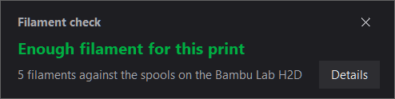
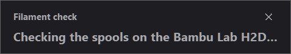

# Using the guard

[← README](../README.md) · **Using the guard** · [The running print](running-print.md) · [Learning](learning.md) · [Spools without a reading](manual-amounts.md) · [Limits](limits.md)

What the guard does from the moment a plate is sliced, what its card and icon show, and what each result means.

- [How it works](#how-it-works)
- [The card](#the-card)
- [The icon and its settings](#the-icon-and-its-settings)
- [What the results mean](#what-the-results-mean)

## How it works

Bambu Studio has no plugin interface (v02.09.01.70: the `plugins` folder holds its network libraries only), so the guard runs beside it:

1. Bambu Studio writes the G-code of each plate it slices to `bamboo_model\<day>\<time>#<pid>#<id>\Metadata\.<pid>.<n>.gcode` in its temp folder: the one Windows gives it, `%TMP%`, else `%TEMP%`. The guard watches that folder. It looks under the folder Windows names, under `%TMP%` and under `%TEMP%`, which are not always the same folder, and in Bambu Studio's own data folder, where Bambu Studio writes when the temp drive is nearly full.
2. From the G-code it reads the grams each filament needs (purge and prime tower included), and its material, colour, product and nozzle.
3. It asks the printer the plate was sliced for what is left on every spool (read-only status over the LAN). When the printer is running a print, it first takes off each spool what that print still needs from it: the answer is for the moment the new print could start. See [The running print](running-print.md).
4. The answer appears as a "Filament check" card inside Bambu Studio's window, bottom right, under the slicing result. With enough of everything it is one line that goes away after 8 seconds; when a filament falls short it is the full table, and it stays until you close it, until that plate is sliced again in that Bambu Studio, or until a check finds something worse. Another plate's fine answer, or another Bambu Studio's, does not take its place, and shows no line while the warning stands.
5. When "Send print job" opens, the guard checks every sliced plate of the project again, all against one reading of the printer. The worst answer that is a warning shows beside that dialog, and names its plate: a finding you ignored, or a result you asked not to be warned of, does not stand in for another plate's warning. A plate that could not be checked (the check is tried once more first) is not taken for a fine one: with no warning on any plate, its "could not be checked" card shows. When the dialog has closed before the check ends (it takes a second or three), a warning found shows in the corner, as after a slice. Of a project with more than 30 sliced plates the 30 sliced last are checked: the card says how many older ones were not, and with nothing else to warn of a card says that alone.

The card belongs to Bambu Studio's window: it is above that window and no other, moves and minimises with it, follows its dark or light mode, and never takes the keyboard. It is still drawn by the guard, which must be running.

## The card

With enough of everything the card is one line:

A check takes a second or three, because the guard asks the printer each time. While one runs that you are waiting for (a plate you just sliced, or one you asked for from the icon) the card says so at once in one line, "Checking the spools on the Bambu Lab H2D…", and the answer takes its place.

For a new slice the line does not cover a full card that is still open; asked for from the icon, it takes the place of any card, as its answer will. Beside "Send print job" nothing shows until there is a warning.

When the guard starts, the first time Bambu Studio runs it shows one line, "Bambu Filament Guard 1.5.0 is watching for sliced plates", which goes away by itself; after `Install.cmd` the install card says it instead. A one-line card that comes while Bambu Studio is minimised waits for its window, and its seconds count from when it shows. With "One line when there is enough" turned off, quiet was asked for: a new slice shows no "Checking…" line, and the guard no start line.

| Button | Does |
|---|---|
| Check again | Asks the printer again, for the same slice: after swapping a spool, no re-slice is needed. |
| Ignore for this project | This finding, on this plate of the project, shows as one line from now on, and not beside "Send print job". It ends, and the full card shows again, when a filament's result changes or the plate uses other filaments; when a filament falls more than 5 g further short than it was when you ignored it; after 7 days; and with "Stop ignoring" on the full card (Details). Another plate of the project is not covered. A project that was never saved has no name of its own: there the ignore holds for the folder Bambu Studio keeps that project's slices in, and reaches no other unsaved project. |
| Amount in A3… | For a spool the printer cannot measure: enter the grams left. See [Spools without a reading](manual-amounts.md). |
| Weigh C3… | Offered when weighing that spool would settle the answer: enter the grams on it. See [Learning, weigh-ins](learning.md#weigh-ins). |
| Details | On the one-line card: the full table. |

## The icon and its settings

Its colour and tooltip are the last result, with its project and plate; while a warning's card stands they stay that warning's, and while checks are paused the icon is grey and says so, whatever you check from its menu meanwhile. A click shows that result again, and the card says when its check was made once that is more than a minute ago; before there is a result, it checks the newest slice. A click while that check runs shows the "Checking…" line again and starts no second check. The menu: check the newest slice now, pause, self-test, the log, and the settings:

- One line when there is enough (`ok_seconds`)
- Warn when a colour is not loaded / when a spool's amount is unknown (`popup_on`: the results that open the full card. "Not enough" and "not loaded" open it whatever that list holds, and one such filament is enough, whatever the others are.)
- Check again at "Send print job" (`at_send`)
- Reserve: 2, 3 or 5 % of the full spool (`spool_reserve_pct`)
- Learn from prints, tray by tray (`learn`, on; see [Learning](learning.md))
- Measure the reserve from past prints (experimental) (`measured_reserve`, off; see [Learning, the measured reserve](learning.md#the-measured-reserve) before turning it on)
- Start automatically
- Forget what was learned…: asks first, on a card with "Forget" and "Keep". Learning then starts again from nothing; what was learned is kept beside it as `learned.json.forgotten`, one copy, replaced the next time something is forgotten (see [Learning](learning.md))

Settings are saved to `config.json` beside the script, which holds only what was changed. The keys, their defaults and their meaning are `DEFAULTS` at the top of [`filament_guard.py`](../filament_guard.py).

## What the results mean

| Result | Meaning |
|---|---|
| Enough | One matching spool holds the need plus the reserve. |
| Tight | One spool holds the need, without the reserve. |
| Needs two spools | No single spool holds it; spools that AMS auto refill goes on between do together: the same product and colour, both in an AMS. AMS auto refill must be on. |
| Not enough | The matching spools together hold less than the need, or hold it only with a spool AMS auto refill does not go on to (another product or shade, the external spool): the note names those and their amounts. |
| Not loaded | No spool of that material is loaded where the print's nozzle can reach it. |
| Colour not loaded | The material is loaded, this colour of it is not. The nearest spool is named and counts for nothing. |
| Unknown | The matching spool reports no remaining amount, or Bambu Studio gives the filament no weight (its profile has density 0). Shown as one line, like "enough", unless "Warn when a spool's amount is unknown" is ticked in the icon's settings. |

A spool matches a filament when it is the same material, on the nozzle that prints it, in the project's colour. While a spool of the project's own product is loaded, only that product counts: a spool of similar colour but another product is named in the note and not counted. When none is loaded, a spool of another product counts, because you can pick it at "Send print job", and the note names it whatever the result, "enough" included: "B3 is PLA Silk+, another product than the project's Bambu PLA Basic".

### The reserve

The AMS's figure is an estimate: it counts what it has fed, so its error grows as the spool empties. On 2026-11-19 a 1 kg spool reported at 105 g ran dry after 84-85 g, one gram before the end of a print that needed 85.3 g. So "enough" asks for the need plus the larger of 10 % of the need (`margin_pct`) and 3 % of a spool's full weight (`spool_reserve_pct`: 30 g on a 1 kg spool). The spool is the largest of those the filament could be printed from, whichever of them is the fullest: with a 250 g and a 1 kg spool of one filament loaded, the 3 % is 30 g. A spool whose full weight the printer does not report counts as a 1 kg spool here, and so does a spool whose amount you entered by hand: that amount rests on a kitchen scale and a typed empty-spool weight. Below the reserve the result is "tight", and the full card shows. An experimental setting, off unless you turn it on, measures the reserve from the guard's own past forecasts instead (see [Learning, the measured reserve](learning.md#the-measured-reserve)).
